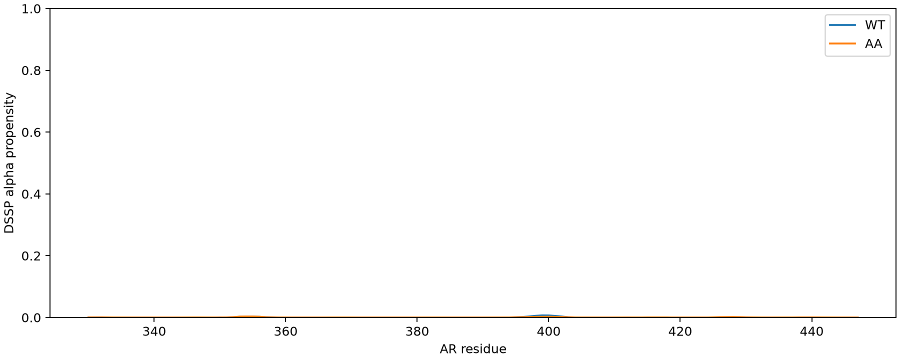

# Tau-5 bAIes/OpenMM ensembles — review package

This repository contains WT and W397A/W433A (AA) ensembles for **GP–AR330–447**, generated with a custom OpenMM implementation of the bAIes coil prior and AF2-derived Bayesian restraints. It is an implementation/ensemble review package, not a claim that the published LAMMPS protocol was reproduced exactly.

## Start here

- [Results and detailed methods](results/README.md)
- [Reference energy/force audit](energy_audit/README.md), with executable tests and [raw native test inputs, logs and force outputs](energy_audit/raw_reference_tests.zip)
- [Simulation runner](results/bAIes_openMM.py), [force field and CMAP](results/inputs/), and per-construct topology, restraint parameters, transfer states, final states and production logs
- [Numerical summary](results/summary.csv), [restraint-distance diagnostics](results/restraint_summary.csv), [WT–AA comparison](results/WT_AA_comparison.csv), and [trajectory provenance and hashes](results/trajectory_provenance.json)
- [Raw trajectories and restart package](../../releases): full WT/AA trajectory segments, checkpoints and runner inputs are provided as a release asset; they are excluded from Git history because the trajectories exceed normal GitHub file limits.

## What was run

Each construct received 2 µs of additional sampling (1,000,000,000 steps) after its ~9 ns restart. We used OpenMM 8.6.1, LangevinMiddle at 298.15 K, friction 0.01 ps⁻¹, timestep 2 fs, hydrogen-bond constraints, and M5 Max OpenCL single precision. There are 20,000 production frames per construct at globally aligned 100 ps reporting intervals, including a two-frame CPU prefix. WT has 19 AF2-derived restrained pairs; AA has 15. The Jeffreys-marginalized bias uses kBT with no extra tuning multiplier.

The paper instead used LAMMPS + PLUMED, 1 fs steps and a Bussi thermostat. The shared sampling duration and frame spacing do not make those protocols identical.

## Why review is requested

Both ensembles are expanded and nearly nonhelical:

| Observable | WT | AA |
|---|---:|---:|
| Mean geometric CA Rg (Å) | 41.86 | 41.72 |
| Mean DSSP alpha fraction (%) | 0.050 | 0.039 |
| Mean R2R3 S-alpha | 0.715 | 0.645 |
| Mean restrained distance minus mu (nm), averaged over pairs | +0.264 | +0.244 |

These are descriptive results under this model. They have not been independently validated against chemical shifts or SAXS, and reweighting of these bAIes ensembles is not included.

## Questions for review

1. Is selecting only 19/15 pairs expected for these AF2 predictions, and do those selected pairs contain enough information about R2/R3 helicity?
2. Are the fitted distogram widths and Jeffreys likelihood being interpreted appropriately? All pair means lie above their mu values; this does not by itself violate a soft Bayesian model.
3. Could hydrogen-bond constraints, 2 fs integration and the different thermostat change these populations materially? What published benchmark would best validate those changes?
4. Is the coil prior expected to yield such low helicity when AF2 contact information is sparse?
5. What additional validation or sampling would distinguish inadequate prior support from a remaining implementation discrepancy?

## What the reference tests establish

Actual patched LAMMPS 2 Aug 2023 tests on three PaaA2 configurations and PLUMED v2.10 tests on five WT plus five AA frames find close agreement in bonds, angles, CMAP and Bayesian bias forces. GPU single-precision bias errors are small. The torsion energy differs mostly by an approximately constant energy zero; small coefficient/force differences remain. The nonbonded XML omits the reference cutoff energy shift, affecting reported energies but leaving ordinary MD forces unchanged away from cutoff boundaries. These findings do not establish all-topology equivalence or experimental validity. See the audit for numerical bounds and limitations.

## Data provenance and reproduction

Analysis scripts preserve production/equilibration separation and reconstruct restart segment times from reporting steps because each XTC file resets its local counters. Input hashes and retained frame ranges are recorded. Model inputs, final portable states and logs are preserved. Runtime environments, credentials and unrelated SEC-SAXS/IDPForge results are excluded.

This package is extracted from [tau5-sec-saxs-analysis](https://github.com/paulrobustelli/tau5-sec-saxs-analysis), snapshot commit `673544057b0d532e5883239a3c9b4d8852bd45ed`, with local native audit outputs added. Original bAIes source: [COSBlab/bAIes-IDP](https://github.com/COSBlab/bAIes-IDP). [Paper](https://pmc.ncbi.nlm.nih.gov/articles/PMC12982490/). The bundled runner is a custom port, not author-supported software; upstream material retains its original provenance.
